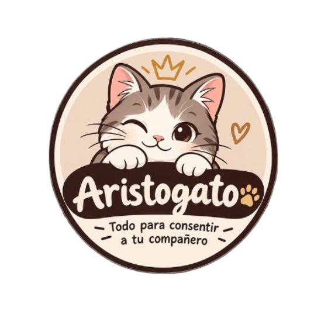
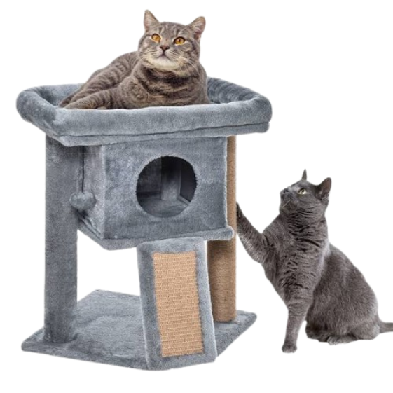
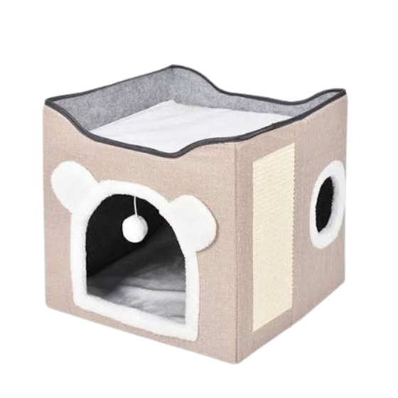
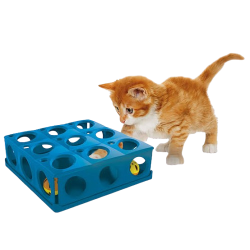

<!DOCTYPE html>
<html lang="es">
<head>
    <meta charset="UTF-8">
    <meta name="viewport" content="width=device-width, initial-scale=1.0">
    <title>Aristogato🐈</title>
    <link rel="stylesheet" href="stilos.css">
</head>
<body>

<header>
    
    <h1>Bienvenido a Aristogato🐈</h1>
    
Todo para consentir a tu compañero

</header>

<nav>
    <a href="#inicio">Inicio</a>
    <a href="#productos">Productos</a>

    <a href="#promociones">Promociones</a>
    <a href="#servicios">Servicios</a>
    <a href="#consejos">Consejos</a>
    <a href="#contacto">Contacto</a>
</nav>

<!-- 1. SECCIÓN INICIO -->
<section id="inicio">

    <h2>Bienvenido a Aristogato 🐈</h2>

    

        <h3>¡Todo para consentir a tu compañero!</h3>

        

            Somos una tienda dedicada a ofrecer productos
            para el cuidado y bienestar de tus mascotas.
        

        

            En Aristogato nos apasiona brindar lo mejor
            para tu compañero felino. Aquí encontrarás
            juguetes, accesorios, alimentos y mucho más.
        

    

    <!-- POR QUÉ ELEGIRNOS -->
    <h2>¿Por qué elegir Aristogato?</h2>

    

        

            <h3>🐾 Calidad</h3>
            

                Buscamos ofrecer productos útiles y de
                calidad para el bienestar de tu gato.
            

        

        

            <h3>❤️ Cariño</h3>
            

                Nos importa el cuidado y la felicidad
                de cada compañero felino.
            

        

        

            <h3>🐱 Variedad</h3>
            

                Contamos con diferentes opciones de
                juguetes, accesorios y productos.
            

        

    

    <!-- INVITACIÓN -->
    

        <h3>¡Tu michi merece lo mejor!</h3>

        

            Explora nuestro catálogo y descubre todo
            lo que tenemos preparado para tu mascota.
        

        <a href="#productos" class="boton-inicio">
            Conocer productos
        </a>

    

</section>

<section id="productos">
    <h2>Productos destacados</h2>
    

      <input type="text" id="buscarProducto" placeholder="Buscar productos...">
      <button type="button"   id="btnBuscar">Buscar</button>
    

      

    

        <article class="producto">
            <h3>Rascador para gatos</h3>
            
            
Ideal para que tu gato pueda jugar y cuidar sus uñas.

            
Precio: 120 Bs

        </article>

        <article class="producto">
            <h3>Casa para gatos</h3>
            
            
Un lugar cómodo y seguro para que tu gato descanse.

            
Precio: 180 Bs

        </article>

        <article class="producto">
            <h3>Juguetes interactivos</h3>
            
            
Estimula la mente y el cuerpo de tu gato.

            
Precio: 45 Bs

        </article>

    

        <h2>Lista de productos</h2>

    <table border="1">
        <tr>
            <th>Producto</th>
            <th>Categoria</th>
            <th>Precio</th>
        </tr>
        <tr>
            <td>Rascador para gatos</td>
            <td>Accesorios</td>
            <td>120 Bs</td>
        </tr>
        <tr>
            <td>Casa para gatos</td>
            <td>Accesorios</td>
            <td>180 Bs</td>
        </tr>
        <tr>
            <td>Juguetes interactivos</td>
            <td>Juguetes</td>
            <td>45 Bs</td>
        </tr>
        <tr>
            <td>Arena para gatos</td>
            <td>Higiene</td>
            <td>60 Bs</td>
        </tr>
    </table>
</section>

<!-- 3. SECCIÓN PROMOCIONES -->
<section id="promociones">

    <h2>Promociones especiales</h2>

    

        ¡En Aristogato tenemos sorpresas para consentir
        a tu compañero felino!
    

    <!-- PROMOCIÓN DESTACADA -->
    

        <h3>🐾 ¡Ofertas para tu michi!</h3>

        

            Descubre nuestros productos destacados y
            encuentra opciones especiales para tu mascota.
        

    

    <!-- TARJETAS DE PROMOCIONES -->
    

        

            <h3>🐱 Combo gatuno</h3>

            

                Combina un rascador con juguetes para
                mantener entretenido a tu gato.
            

            Consulta el precio

        

        

            <h3>🎾 Diversión felina</h3>

            

                Descubre nuestra variedad de juguetes
                para que tu mascota se divierta.
            

            Productos disponibles

        

        

            <h3>🏠 Hogar cómodo</h3>

            

                Encuentra casas y accesorios para crear
                un espacio cómodo para tu compañero.
            

            Consulta disponibilidad

        

    

    <!-- INFORMACIÓN ADICIONAL -->
    

        <h3>¿Cómo aprovechar nuestras promociones?</h3>

        <ol>
            <li>Explora las promociones disponibles.</li>
            <li>Elige los productos que te interesan.</li>
            <li>Contáctanos para consultar precios y disponibilidad.</li>
        </ol>

    

</section>
<section id="servicios">
    <h2>Servicios</h2>

    <article>
        <h3>Entrega a domicilio</h3>
        
Ofrecemos entrega a domicilio para que recibas tus productos de manera cómoda y segura.

    </article>

    <article>
        <h3>Pedidos personalizados</h3>
        
Podemos preparar un kit de acuerdo a sus gustos.

    </article>

    <article>
        <h3>Asesoramiento en cuidado felino</h3>
        
Nuestro equipo está disponible para brindarte asesoramiento sobre el cuidado y bienestar de tu gato.

    </article>
</section>
<!-- 5. SECCIÓN CONSEJOS -->
<section id="consejos">

    <h2>Consejos para cuidar a tu gato 🐾</h2>

    

        Los gatos necesitan cuidados, atención y un
        ambiente seguro. Aquí te compartimos algunas
        recomendaciones para su bienestar.
    

    

        <!-- ALIMENTACIÓN -->
        <article class="tarjeta-consejo">

            <h3>🥣 Alimentación</h3>

            

                Una alimentación adecuada ayuda a mantener
                a tu gato saludable.
            

            <ul>
                <li>Ofrece alimento apropiado para su edad.</li>
                <li>Mantén agua fresca y limpia.</li>
                <li>Evita darle alimentos tóxicos para gatos.</li>
                <li>Respeta sus horarios de alimentación.</li>
            </ul>

        </article>

        <!-- HIGIENE -->
        <article class="tarjeta-consejo">

            <h3>🧼 Higiene</h3>

            

                Mantener limpio su entorno es importante
                para su comodidad.
            

            <ul>
                <li>Limpia su arenero regularmente.</li>
                <li>Lava sus recipientes de comida y agua.</li>
                <li>Cepilla su pelaje según sus necesidades.</li>
                <li>Mantén limpio su espacio de descanso.</li>
            </ul>

        </article>

        <!-- SALUD -->
        <article class="tarjeta-consejo">

            <h3>🏥 Salud</h3>

            

                La prevención y los controles veterinarios
                ayudan a cuidar su salud.
            

            <ul>
                <li>Realiza controles veterinarios.</li>
                <li>Mantén al día sus vacunas.</li>
                <li>Consulta sobre la desparasitación.</li>
                <li>Acude al veterinario si notas cambios
                    en su comportamiento o salud.</li>
            </ul>

        </article>

        <!-- ENTRETENIMIENTO -->
        <article class="tarjeta-consejo">

            <h3>🎾 Entretenimiento</h3>

            

                El juego permite que tu gato se mantenga
                activo y estimulado.
            

            <ul>
                <li>Utiliza juguetes apropiados.</li>
                <li>Dedica tiempo para jugar con él.</li>
                <li>Proporciona rascadores.</li>
                <li>Ofrece espacios para explorar.</li>
            </ul>

        </article>

        <!-- DESCANSO -->
        <article class="tarjeta-consejo">

            <h3>🛏️ Descanso</h3>

            

                Los gatos necesitan lugares tranquilos
                para descansar.
            

            <ul>
                <li>Prepara una cama cómoda.</li>
                <li>Busca un lugar tranquilo.</li>
                <li>Evita interrumpir sus horas de sueño.</li>
                <li>Mantén su espacio limpio.</li>
            </ul>

        </article>

     

    

    <!-- CONSEJO FINAL -->
    

        <h3>Un pequeño recordatorio ❤️</h3>

        

            Cada gato tiene necesidades diferentes.
            Bríndale paciencia, cariño y atención.
            Ante cualquier duda sobre su salud, consulta
            con un profesional veterinario.
        

    

</section>
<!-- CONTACTO Y FORMULARIO -->
<section id="contacto">

    <h2>Contáctanos</h2>

    

        <h3>Información de contacto</h3>

        
📱 WhatsApp: 7000000000

        
📷 Instagram: @aristogatos

    

    

        <h3>Envíanos un mensaje</h3>

        <form id="formulario">

            <label for="nombre">Nombre:</label>
            <input
                type="text"
                id="nombre"
                placeholder="Escribe tu nombre"
                required
            >

            <label for="correo">Correo electrónico:</label>
            <input
                type="email"
                id="correo"
                placeholder="Escribe tu correo"
                required
            >

            <label for="asunto">Asunto:</label>

            <select id="asunto" required>
                <option value="">Selecciona un asunto</option>
                <option value="Productos">Productos</option>
                <option value="Pedidos">Pedidos</option>
                <option value="Promociones">Promociones</option>
                <option value="Otros">Otros</option>
            </select>

            <label for="mensaje">Mensaje:</label>

            <textarea
                id="mensaje"
                placeholder="Escribe tu mensaje"
                required
            ></textarea>

            <button type="submit">Enviar mensaje</button>

        </form>

        

        <h3>Mensajes registrados</h3>

        <ul id="listaUsuarios"></ul>

    

</section>

<footer>
    
&copy; 2026 Aristogato🐈. Todos los derechos reservados.

</footer>

</body>
</html>
